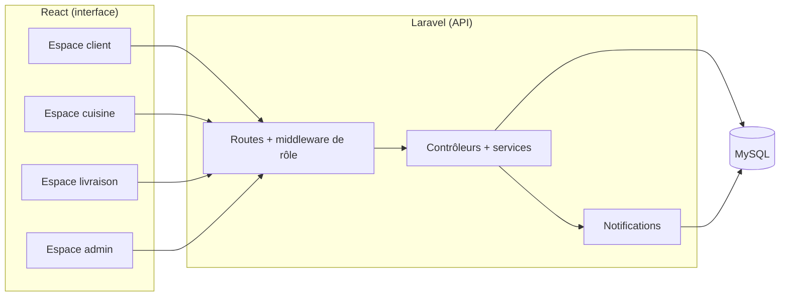
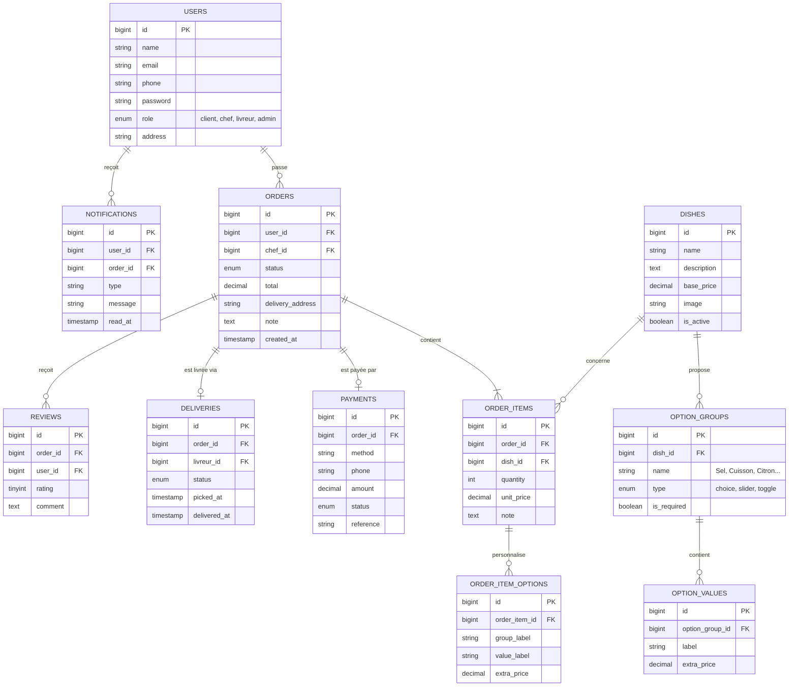
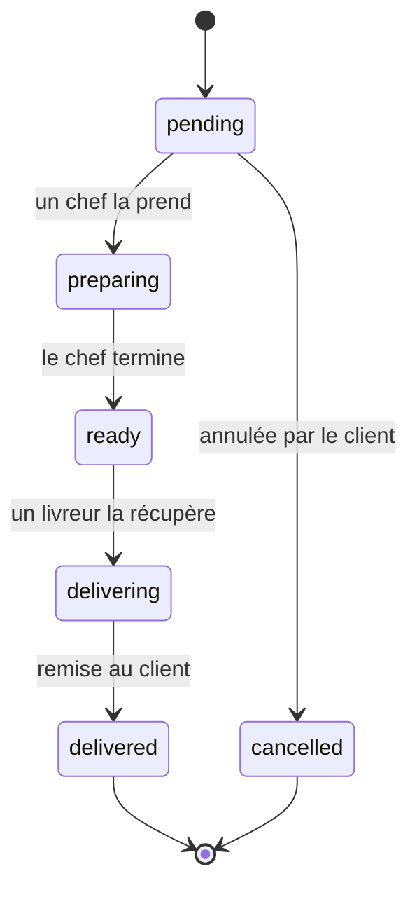

# Masterchef : Take it as you feel !

Commandez votre plat comme vous l'imaginez, pas comme on vous le sert.

Masterchef est un site de commande de repas où c'est le client qui écrit la recette. Sel, sucre, piment, vinaigre, citron, cuisson : tout se règle avant de commander, puis une cuisine prépare le plat exactement comme demandé et le fait livrer.

Projet réalisé pour le cours d'e-commerce à l'ISIG-Goma.

**Stack :** Laravel (API) · React (interface) · MySQL (base de données)

## Sommaire

1. [D'où vient l'idée](#dou-vient-lidée)
2. [Le problème](#le-problème)
3. [Notre solution](#notre-solution)
4. [Comment ça marche](#comment-ça-marche)
5. [Qui fait quoi](#qui-fait-quoi)
6. [Partie technique](#partie-technique)
7. [Limites actuelles et suite](#limites-actuelles-et-suite)
8. [Installation](#installation)

## D'où vient l'idée

Elle part d'une petite frustration, celle de tous ceux qui commandent à manger. On choisit un plat sur un menu et on le reçoit tel quel. Trop salé, pas assez relevé, une sauce qu'on n'aime pas, et personne pour en tenir compte.

Un exemple concret nous a servi de départ : un burger avec du citron raffiné sur les épices. À Goma, aucun restaurant ne le propose, et aucun ne vous laisse le demander. Le problème n'est pas la cuisine, c'est que le client n'a pas son mot à dire.

## Le problème

- Les menus sont figés. Si un plat ne convient pas à 100 %, on le mange quand même ou on change de plat.
- Demander une modification par téléphone ou par message est aléatoire : elle se perd, elle est mal comprise, ou on répond que ce n'est pas possible.
- Les goûts varient beaucoup d'une personne à l'autre (sel, sucre, piquant, acidité), mais la plupart des offres de livraison les ignorent.

## Notre solution

Un site où le plat se construit étape par étape. Le client choisit une base (un burger, par exemple), règle chaque paramètre avec des curseurs et des options, ajoute une remarque libre s'il le souhaite, et valide. Sa commande part dans une file d'attente. Un chef la prend en charge, cuisine selon la fiche exacte du client, et marque le plat comme prêt. Le client reçoit une notification, puis la livraison commence.

Les réglages ne sont pas un simple commentaire perdu au bas d'un bon de commande. Ils font partie de la commande, et le chef les voit clairement sur sa fiche.

## Comment ça marche

1. Le client crée un compte et se connecte.
2. Il choisit un plat de base dans le catalogue.
3. Il le personnalise : sel, sucre, piquant, citron, vinaigre, épices, cuisson, ingrédients à ajouter ou à retirer, plus une note libre.
4. Le prix se met à jour pendant qu'il règle son plat, parce que certaines options coûtent un supplément.
5. Il passe au paiement (simulé pour le moment) et valide.
6. La commande entre dans la file d'attente de la cuisine.
7. Un chef la prend, prépare le plat et indique quand il est prêt.
8. Le client est prévenu, puis un livreur récupère la commande et l'apporte.
9. Après réception, le client peut laisser un avis.

## Qui fait quoi

| Rôle | Ce qu'il fait |
|---|---|
| Client | Compose son plat, paie, suit sa commande, donne son avis |
| Chef | Consulte la file d'attente, prend une commande, cuisine, signale quand c'est prêt |
| Livreur | Voit les commandes prêtes, en prend une, la livre, confirme la remise |
| Administrateur | Gère le catalogue, les options, les prix, les comptes, et suit les statistiques |

---

## Partie technique

### Stack

| Couche | Technologie | Rôle dans le projet |
|---|---|---|
| Serveur | Laravel (PHP) | API REST, règles métier, authentification, rôles, notifications |
| Interface | React | Les quatre espaces (client, cuisine, livraison, admin) et le configurateur de plat |
| Base de données | MySQL | Utilisateurs, catalogue, commandes, personnalisations, paiements |
| Échanges | JSON sur HTTP | React appelle l'API Laravel, qui lit et écrit dans MySQL |

### Architecture générale



React ne parle jamais directement à la base. Tout passe par l'API, qui vérifie qui fait la demande, applique les règles (prix, statuts, droits) et seulement ensuite écrit dans MySQL.

### Base de données



Un détail important : la table `order_item_options` garde **le libellé et le prix de chaque réglage au moment de la commande** (une copie, pas juste un lien vers l'option). Si l'administrateur change un prix ou renomme une option plus tard, les anciennes commandes ne bougent pas, et la fiche du chef reste exacte.

### Cycle de vie d'une commande



| Statut | Signification | Qui le fait passer |
|---|---|---|
| `pending` | En file d'attente | Création de la commande |
| `preparing` | Un chef cuisine | Chef |
| `ready` | Prête à être livrée | Chef |
| `delivering` | En route | Livreur |
| `delivered` | Livrée | Livreur |
| `cancelled` | Annulée (possible seulement en `pending`) | Client |

Chaque changement de statut crée une notification pour le client.

### API

Toutes les routes sont préfixées par `/api` et renvoient du JSON. Sauf l'inscription, la connexion et le catalogue, elles demandent d'être connecté.

| Méthode | Route | Rôle | Description |
|---|---|---|---|
| POST | `/register` | public | Créer un compte |
| POST | `/login` | public | Se connecter |
| POST | `/logout` | connecté | Se déconnecter |
| GET | `/me` | connecté | Profil de l'utilisateur courant |
| GET | `/dishes` | public | Liste des plats actifs |
| GET | `/dishes/{id}` | public | Un plat avec ses groupes d'options et valeurs |
| POST | `/orders/preview` | client | Calcule le prix d'une configuration sans créer de commande |
| POST | `/orders` | client | Crée la commande avec ses personnalisations |
| GET | `/orders` | client | Historique du client |
| GET | `/orders/{id}` | client | Détail et statut d'une commande |
| POST | `/orders/{id}/cancel` | client | Annule (seulement si `pending`) |
| POST | `/orders/{id}/reviews` | client | Laisse un avis (seulement si `delivered`) |
| GET | `/kitchen/queue` | chef | File d'attente, de la plus ancienne à la plus récente |
| POST | `/kitchen/orders/{id}/take` | chef | Prend une commande |
| POST | `/kitchen/orders/{id}/ready` | chef | Marque la commande prête |
| GET | `/deliveries/available` | livreur | Commandes prêtes à livrer |
| POST | `/deliveries/{order}/pickup` | livreur | Récupère la commande |
| POST | `/deliveries/{order}/complete` | livreur | Confirme la livraison |
| GET | `/notifications` | connecté | Notifications de l'utilisateur |
| POST | `/notifications/{id}/read` | connecté | Marque comme lue |
| CRUD | `/admin/dishes`, `/admin/options`, `/admin/users` | admin | Gestion du catalogue et des comptes |
| GET | `/admin/stats` | admin | Chiffres clés |

### La logique importante côté Laravel

**Le prix est toujours recalculé par le serveur.** Le total affiché dans React sert à l'aperçu, mais à la validation Laravel recalcule tout à partir de la base, pour que personne ne puisse envoyer un faux montant.

```php
class PriceCalculator
{
    public function total(Dish $dish, array $valueIds, int $quantity = 1): float
    {
        // On ne prend que les valeurs qui appartiennent bien à ce plat
        $extras = OptionValue::whereIn('id', $valueIds)
            ->whereHas('group', fn ($q) => $q->where('dish_id', $dish->id))
            ->sum('extra_price');

        return ($dish->base_price + $extras) * $quantity;
    }
}
```

**Un chef prend une commande sans conflit.** Si deux chefs cliquent en même temps sur la même commande, un seul doit gagner. On verrouille la ligne dans une transaction :

```php
DB::transaction(function () use ($orderId, $chef) {
    $order = Order::where('id', $orderId)
        ->where('status', OrderStatus::Pending)
        ->lockForUpdate()
        ->firstOrFail();

    $order->update([
        'status'  => OrderStatus::Preparing,
        'chef_id' => $chef->id,
    ]);
});
```

Si la commande n'est plus en `pending`, le second chef reçoit une erreur claire et sa file se rafraîchit.

**Les rôles passent par un middleware.** Chaque groupe de routes est protégé, par exemple `Route::middleware(['auth:sanctum', 'role:chef'])` pour tout ce qui touche à la cuisine. Un client qui essaie d'appeler `/kitchen/queue` reçoit un refus, même s'il connaît l'adresse.

**Estimation du temps d'attente.** Elle se calcule à partir du nombre de commandes `pending` devant celle du client, multiplié par un temps moyen de préparation, divisé par le nombre de chefs actifs.

**Notifications.** À chaque changement de statut, Laravel enregistre une ligne dans `notifications`. Côté React, l'interface vérifie les nouvelles notifications à intervalle régulier. Un passage au temps réel reste possible plus tard.

### Côté React

Le configurateur de plat est le composant central : il charge un plat avec ses groupes d'options, garde les choix de l'utilisateur en mémoire, appelle `/orders/preview` pour afficher le prix à jour, puis envoie le tout à `/orders` à la validation.

Organisation prévue du code :

```
src/
├── api/                 # appels vers l'API Laravel
├── components/
│   ├── DishConfigurator/   # curseurs, choix, aperçu du prix
│   ├── OrderStatusBadge/
│   └── NotificationBell/
├── pages/
│   ├── client/          # catalogue, personnalisation, panier, suivi
│   ├── kitchen/         # file d'attente, fiche de commande
│   ├── delivery/        # commandes à livrer
│   └── admin/           # catalogue, comptes, statistiques
├── routes/              # routes protégées selon le rôle
└── hooks/               # useAuth, useOrders, useNotifications
```

Et côté Laravel :

```
app/
├── Enums/OrderStatus.php
├── Http/
│   ├── Controllers/     # Auth, Dish, Order, Kitchen, Delivery, Admin
│   └── Middleware/CheckRole.php
├── Models/              # User, Dish, OptionGroup, OptionValue, Order...
├── Services/PriceCalculator.php
└── Notifications/OrderStatusChanged.php
```

### Sécurité

- Mots de passe chiffrés, accès à l'API par jeton après connexion.
- Validation de toutes les données reçues (options qui appartiennent bien au plat, quantités valides, adresse présente).
- Droits vérifiés à chaque requête : un client ne voit que ses commandes, un chef ne touche qu'aux commandes en cuisine.
- Prix recalculé côté serveur, jamais accepté tel quel depuis le navigateur.

### Paiement

Le paiement est simulé pour la démonstration, sur le modèle du Mobile Money : le client saisit un numéro, la commande passe à « payée » sans qu'aucun vrai argent ne circule. La table `payments` est déjà prête pour brancher un vrai service plus tard.

---

## Limites actuelles et suite

**Limites**
- Les plats sont préparés par des chefs humains. Une cuisine automatisée reste une piste lointaine.
- La livraison est pensée pour une zone limitée de la ville.
- Les options sont définies à l'avance par l'administrateur, le client ne peut pas encore inventer un ingrédient.

**Pistes**
- Sauvegarder « ses recettes » pour recommander en un clic.
- Partager une recette avec d'autres clients.
- Abonnements hebdomadaires.
- Notifications en temps réel.
- Vrai paiement Mobile Money.

## Installation

À venir.